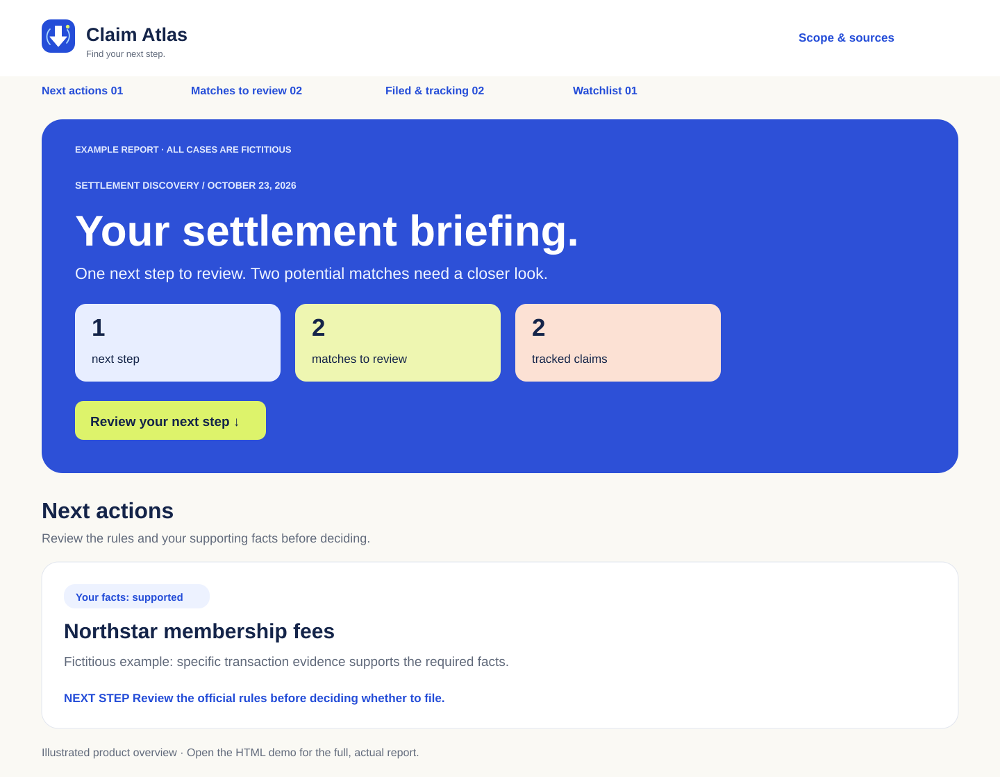

<picture>
  <source media="(prefers-color-scheme: dark)" srcset="skills/claim-atlas/assets/logo-lockup-dark.svg">
  
</picture>

# A lead is the beginning. Evidence tells you what comes next.

Claim Atlas helps you find potential class action settlements, understand why they may fit, and keep a personal record of claims and payments. It is a portable AI skill: your assistant supplies searchable email and web tools; Claim Atlas supplies the workflow and private workspace.

## Start where you are

**Have a claim notice?** Choose email notices. Claim Atlas looks for invitations, deadlines, administrator follow-ups and payments in your selected account(s), over the last 12 months by default.

**Might have missed a notice?** Choose public settlements. Claim Atlas discovers current cases, checks official requirements, then searches your selected email for relevant purchases, accounts or activity during each case's class period.

A general request presents these two choices, then asks which connected mailbox to use. Explicit choices skip repeated questions. You can request both. No connection? Public research can proceed with personal matching deferred. Nothing submits a claim or signs an attestation.

## Read the evidence, then decide

The report shows potential matches with the facts that support them, the facts still missing, and a next step. Supporting emails have direct links so you can open the original message and save or print a copy if proof is needed. Private message links never enter public examples. Company-name overlap alone is a lead. Missing mail is not proof of ineligibility. A pending investigation is not an open claim. You decide whether you can truthfully meet the official requirements.

[Open the fictitious report demo](docs/demo-report.html). Download the HTML to view it locally; GitHub's file view displays source. The example cases are invented.

[](docs/preview-desktop.svg)

*Scalable illustrated overview. The HTML demo contains the full report.*

## Install

Requirements: Python 3.10+ for local installation/helpers, and an assistant capable of reading skills, searching the web and accessing the email provider you choose. No additional Python packages or Git Bash are needed.

```text
git clone https://github.com/tportela1/claim-atlas.git
cd claim-atlas
python tools/manage.py install --host codex
```

Use `--host claude` for Claude Code or `--host agents` for the shared Agent Skills directory. Installation copies the skill into that host's skill directory; it does not connect your accounts or grant permissions. Restart/reload your assistant, then invoke `$claim-atlas` in Codex, `/claim-atlas` in Claude Code, or request it by name in another compatible host.

Assistants supporting skill uploads can use [the ZIP](dist/claim-atlas.zip) or [the .skill edition](dist/claim-atlas.skill). File-only assistants can use [the embedded guide edition](dist/claim-atlas-single-file.md). Upload/tool support varies by host; a file cannot supply a missing mail connection or persistent storage.

Try: “Find public settlements and match my Gmail.” Or: “Check my Outlook for claim notices.” Account choice applies only to the accounts selected for the run. Gmail priority never silently adds Outlook.

## Keep your own record

Say “I filed,” “watch this case,” “dismiss this lead,” or “I received $24” to explicitly record progress. Research alone never records a submission. Automatic enrollment and received payments are separate events; expected money is not received money.

All local hosts use one private workspace: `~/.claim-atlas/claims.json` and `~/.claim-atlas/reports/`. Reports contain no scripts, external resources or analytics. Never publish them. Skill upgrades preserve old installer-managed output but do not automatically import another skill's tracker. Request an import if you want one. Hosted assistants without local storage return exports to carry between sessions.

## Develop and contribute

```text
python scripts/build-demo.py
python tools/manage.py build
python tools/manage.py check
```

The standard-library tools install the skill, build upload editions, verify distribution contents and test report behavior. They do not access mail or determine legal eligibility. Review [the product brief](docs/product.md), [architecture](docs/architecture.md), and [contribution guide](CONTRIBUTING.md).

Public source corrections and community leads are welcome through the issue template. There is no hosted crowdsourcing service or shared purchase-history database. Include public facts and URLs, never private mail, claim credentials or medical information. Claim Atlas is independently maintained under the [MIT license](LICENSE).
